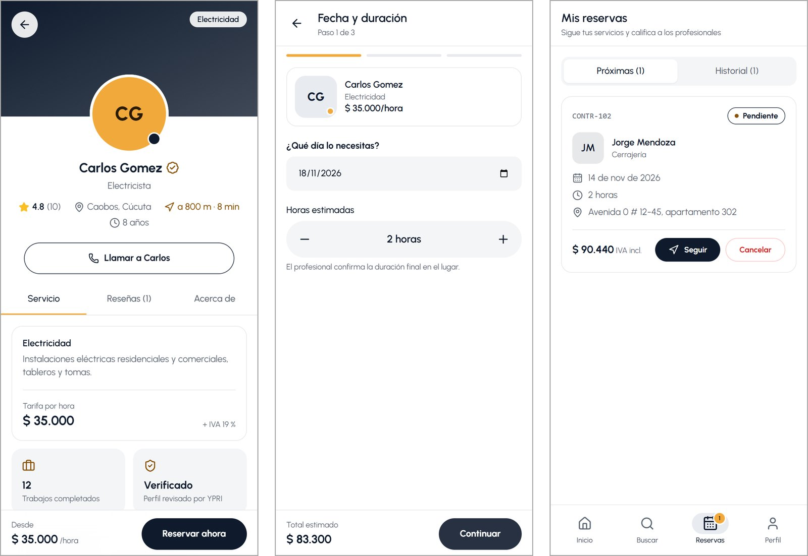
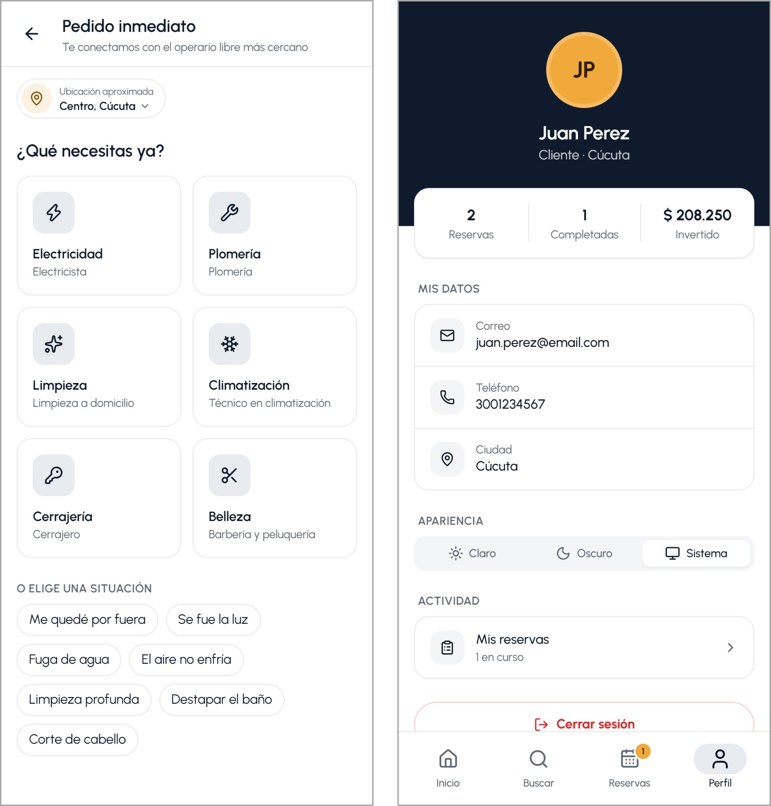
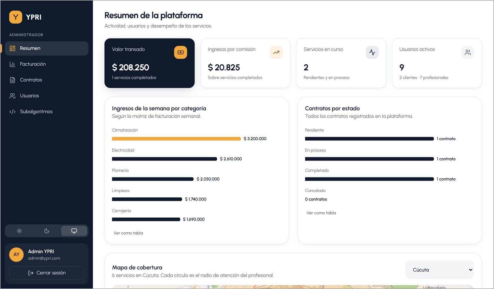

# YPRI — Documentación técnica / Technical documentation

**Proyecto / Project:** YPRI — Plataforma de servicios a domicilio («Talento al toque»)
**Asignatura / Course:** Diseño Funcional — Ingeniería de Software, semestre VIII
**Estudiantes / Students:** Jann Pierre Ortiz Zambrano y Josué David Rincón Palomino
**Docente / Professor:** Robinson Damián Gómez Sánchez
**Año / Year:** 2026

Este archivo tiene dos partes con la misma información: **Parte 1 en español** y **Part 2 in English**.
This file has two parts with the same information: **Parte 1 en español** and **Part 2 in English**.

---

# PARTE 1 — ESPAÑOL

## 1. Información general del proyecto

### 1.1 Descripción general del aplicativo
YPRI conecta a personas que necesitan un servicio en su casa o negocio (electricidad, plomería, limpieza, climatización, cerrajería y belleza) con profesionales independientes de Cúcuta y otras ciudades de Colombia. El aplicativo en Python funciona por consola (`backend/main.py`) y con una interfaz gráfica de escritorio en Tkinter (`backend/app_gui.py`). Maneja tres roles:

- **Cliente:** busca servicios, ve profesionales cercanos, cotiza, contrata y califica.
- **Prestador:** publica, modifica y elimina sus servicios, atiende contratos, ve su rendimiento y exporta o importa servicios en Excel.
- **Administrador:** audita usuarios, servicios, contratos y matrices de facturación, ve estadísticas, gestiona el catálogo y hace reportes y respaldos.

La información queda guardada en archivos y se recupera la próxima vez que se abre el programa.

### 1.2 Objetivo del proyecto
Desarrollar una plataforma que reduzca el tiempo y la desconfianza al contratar servicios a domicilio, integrando en un mismo aplicativo los temas de Diseño Funcional:
- Unidad 1: fundamentos de programación.
- Unidad 2: estructuras repetitivas, estructuras de datos, vectores, matrices y subalgoritmos.
- Unidad 3: archivos, Excel y programación orientada a objetos.

### 1.3 Requerimientos funcionales principales
1. Registrar usuarios e iniciar sesión según el rol (cliente, prestador o administrador).
2. Publicar, consultar, modificar y eliminar servicios del catálogo.
3. Buscar y ordenar servicios por tarifa, calificación, categoría o ciudad.
4. Cotizar y contratar servicios con cálculo de IVA; cambiar el estado del contrato y calificarlo.
5. Analizar la facturación con matrices: totales, promedios y categoría líder.
6. Encontrar profesionales cercanos con geolocalización y hacer pedidos inmediatos por palabras clave.
7. Guardar y recuperar la información en archivos, y exportar e importar datos en Excel.

### 1.4 Tecnologías y bibliotecas utilizadas
| Tecnología | Uso |
|---|---|
| Python 3.10 o superior (probado con 3.12) | Lenguaje del aplicativo |
| `openpyxl` (externa) | Leer y escribir archivos Excel `.xlsx` |
| `tkinter` / `ttk` (estándar) | Interfaz gráfica de escritorio |
| `json`, `os`, `datetime` (estándar) | Archivo de datos e historial |
| `math`, `unicodedata` (estándar) | Distancias de geolocalización y normalización de texto |
| `unittest` (estándar) | Pruebas automatizadas |
| Next.js 14, React 18 y TypeScript (versión web) | Interfaz web de YPRI con la identidad «Talento al toque» |
| Tailwind CSS, Leaflet y OpenStreetMap (versión web) | Estilos, mapas y ubicación de los profesionales |

### 1.5 Versión web «Talento al toque»: la cara del proyecto
YPRI se presenta a los usuarios con su versión web, que está en la carpeta `web/`. Tiene la identidad visual «Talento al toque», con azul noche, ámbar, la tipografía Urbanist e ilustraciones propias, y funciona en el celular y en el computador con tema claro u oscuro. Las figuras 1 a 6 muestran sus pantallas principales.

La web usa las mismas reglas de negocio y los mismos datos de ejemplo que el aplicativo en Python:
- Roles de cliente, profesional y administrador.
- IVA del 19 % y comisión del 10 %.
- Matriz de facturación semanal.
- Búsqueda por palabras clave y cercanía.

Estas reglas están reescritas en TypeScript en `web/lib/` y la web guarda sus datos en el navegador (localStorage). **No llama al código Python**. Por eso, la ubicación de los temas de la asignatura que se documenta en el apartado 2 corresponde al aplicativo en Python de la carpeta `backend/`, que es el que pide la asignatura.


*Nota.* Bienvenida con el lema «Talento al toque», presentación del seguimiento y pantalla de ingreso con cuentas de demostración. Capturas de la versión web con datos de ejemplo.


*Nota.* El cliente escribe lo que necesita («se me quedaron las llaves»), filtra por oficio y ciudad y ve en el mapa a los profesionales más cercanos y su tiempo de llegada.



*Nota.* El valor se calcula con la tarifa por hora más el IVA del 19 %, el mismo cálculo de `calcular_liquidacion_contrato()` en Python.



*Nota.* El pedido inmediato asigna al operario libre más cercano; el perfil permite elegir el tema claro, oscuro o del sistema.


*Nota.* Las ganancias descuentan la comisión del 10 % y la retención del 4 %, como `calcular_comision_plataforma()` en Python.



*Nota.* Las barras de ingresos por categoría salen de la misma matriz de facturación semanal de 5 × 6 del aplicativo en Python.

### 1.6 Estructura general de carpetas y archivos
```text
YPRI/
├── DOCUMENTACION_TECNICA.md      ← este documento (español e inglés)
├── requirements.txt              ← dependencias de Python
├── README.md
├── backend/                      ← APLICATIVO EN PYTHON
│   ├── main.py                   ← punto de entrada (menú por consola y opción --gui)
│   ├── app_gui.py                ← interfaz gráfica Tkinter
│   ├── ejecutar_pruebas.py       ← corre todas las pruebas y guarda la evidencia
│   ├── core/
│   │   ├── constantes.py         ← tuplas inmutables (roles, categorías, ciudades, estados, IVA)
│   │   └── validaciones.py       ← entrada de datos validada (input, try/except, conversiones)
│   ├── data/
│   │   └── database.py           ← vectores (listas de diccionarios), matrices y sesión (global)
│   ├── models/                   ← GUÍA 11: clases (POO)
│   │   ├── usuario.py            ← Usuario (base) y Cliente, Prestador, Administrador (herencia)
│   │   ├── servicio.py           ← Servicio (getters/setters, __eq__, __str__)
│   │   └── factura.py            ← Factura (__add__, __radd__, __eq__, __str__)
│   ├── modules/
│   │   ├── auth.py               ← login y registro (usa las clases de usuario)
│   │   ├── servicios.py          ← catálogo, búsqueda, ordenamiento, publicar, modificar, eliminar
│   │   ├── contratos.py          ← cotización, contratos y estados
│   │   ├── calificaciones.py     ← calificación de servicios
│   │   ├── admin.py              ← estadísticas, auditoría y facturación consolidada
│   │   ├── matrices.py           ← GUÍA 9: recorridos y operaciones con matrices
│   │   ├── subalgoritmos.py      ← GUÍA 10: funciones, procedimientos y lambdas
│   │   ├── geolocalizacion.py    ← distancias, profesionales cercanos y seguimiento
│   │   ├── palabras_clave.py     ← búsqueda rápida por necesidad (cadenas)
│   │   ├── persistencia.py       ← GUÍA 11: guardar y cargar datos en archivos
│   │   └── reportes_excel.py     ← GUÍA 11: exportar e importar Excel
│   ├── datos/                    ← archivos de datos (se crean y actualizan solos)
│   │   ├── ypri_datos.json       ← información del sistema (usuarios, servicios, contratos, matrices)
│   │   ├── historial_operaciones.txt ← historial de operaciones (modo "a")
│   │   └── plantilla_servicios.xlsx  ← Excel de ejemplo para importar servicios
│   ├── reportes/
│   │   └── reporte_ypri.xlsx     ← reporte exportado (Servicios, Contratos, Facturación semanal)
│   ├── evidencias/               ← evidencias de funcionamiento (pruebas, corridas y capturas)
│   ├── tests_guia10.py           ← pruebas de subalgoritmos e integración
│   ├── tests_geolocalizacion.py  ← pruebas de geolocalización
│   ├── tests_pedido_rapido.py    ← pruebas de búsqueda rápida y pedido inmediato
│   ├── tests_guia11.py           ← pruebas de archivos, Excel y POO
│   └── ejercicio_practico_guia10.py ← ejercicio guiado de la Guía 10 (inventario)
├── docs/                         ← documentación en DOCX y PDF, y capturas de la versión web
├── documents/                    ← informes de entrega de guías anteriores y evidencias de la Guía 7
└── web/                          ← versión web de YPRI «Talento al toque» (Next.js)
```

### 1.7 Instrucciones de instalación y ejecución
1. Instalar Python 3.10 o superior. En Windows, marcar «Add Python to PATH» y dejar activado «tcl/tk and IDLE», que trae Tkinter.
2. Abrir una terminal en la carpeta `YPRI` e instalar las dependencias:
   ```bash
   pip install -r requirements.txt
   ```
3. Ejecutar el aplicativo por consola:
   ```bash
   cd backend
   python main.py
   ```
4. Abrir la interfaz gráfica: elegir la opción 5 del menú principal, o ejecutar:
   ```bash
   python main.py --gui
   ```
5. Correr todas las pruebas. El resultado queda en `evidencias/resultado_pruebas.txt`:
   ```bash
   python ejecutar_pruebas.py
   ```

**Cuentas de demostración**

| Rol | Correo | Contraseña |
|---|---|---|
| Cliente | juan.perez@email.com | juan123 |
| Prestador | carlos.gomez@email.com | carlos456 |
| Administrador | admin@ypri.com | admin2026 |

**Recorrido sugerido para la sustentación**
1. Iniciar sesión como administrador y entrar a la opción 11, «Archivos y reportes Excel».
2. Exportar el reporte e importar `datos/plantilla_servicios.xlsx`: se agregan 3 servicios y se rechaza 1 fila con tarifa inválida.
3. Ver el catálogo (opción 2) y eliminar un servicio (opción 10).
4. Salir del programa, volver a abrirlo y comprobar que los cambios se conservaron.

Si se borra `datos/ypri_datos.json`, el programa lo crea de nuevo con los datos iniciales.

**Versión web (opcional).** Requiere Node.js 18 o superior. Desde la carpeta `YPRI` se ejecutan estos comandos y luego se abre http://localhost:3000 en el navegador:
```bash
npm --prefix web install
npm run dev
```

## 2. Identificación de los temas implementados

Las rutas son relativas a la carpeta `YPRI/`.

### 2.1 Fundamentos de programación (Unidad 1)

| # | Tema | Archivo | Función, clase o método | Descripción de su aplicación |
|---|---|---|---|---|
| 1 | Variables y tipos de datos | `backend/data/database.py` | vectores `usuarios`, `servicios`, `contratos` | Cada registro combina `str` (nombre, código), `float` (`tarifa_hora`, `total`), `int` (`horas`, `num_contratos`) y `bool` (`disponible`). |
| 1 | Variables y tipos de datos | `backend/core/constantes.py` | `IVA_PORCENTAJE` | Variable `float` (0.19) con la tasa de IVA que usan todos los cálculos. |
| 2 | Operadores aritméticos | `backend/modules/subalgoritmos.py` | `calcular_liquidacion_contrato()` | Multiplica tarifa por horas, resta el descuento y suma el IVA del contrato. |
| 2 | Operadores aritméticos | `backend/modules/geolocalizacion.py` | `distancia_haversine()` | Calcula la distancia en km entre el cliente y el profesional con `*`, `/`, `**` y funciones de `math`. |
| 2 | Operadores lógicos y de comparación | `backend/modules/servicios.py` | `quitar_servicio_del_catalogo()` | Usa `!=`, `and` e `in` para impedir que un prestador borre servicios ajenos o con contratos activos. |
| 2 | Operadores lógicos y de comparación | `backend/core/validaciones.py` | `pedir_correo()` | Combina `len(...) == 2 and ... and "." in ...` para validar el formato del correo. |
| 3 | Entrada y salida de datos | `backend/main.py` | `menu_cliente()`, `menu_prestador()`, `menu_admin()` | Muestran las opciones con `print()` y leen la elección con `input()`. |
| 3 | Conversión de datos | `backend/core/validaciones.py` | `pedir_entero()`, `pedir_float()` | Convierten el texto con `int()` y `float()` y controlan el error con `try/except ValueError`. |
| 3 | Conversión de datos | `backend/models/servicio.py` | setter `Servicio.tarifa_hora` | Convierte la tarifa (texto o Excel) a `float` antes de validarla. |
| 4 | Estructuras condicionales | `backend/main.py` | `main()` y menús por rol | `if / elif / else` según la opción elegida y el rol del usuario. |
| 4 | Condiciones compuestas y anidadas | `backend/modules/contratos.py` | `actualizar_estado_contrato()` | Valida permisos con `if not usuario or usuario["rol"] not in (...)` y anida la búsqueda del contrato. |

### 2.2 Estructuras repetitivas y de datos (Unidad 2)

| # | Tema | Archivo | Función, clase o método | Descripción de su aplicación |
|---|---|---|---|---|
| 5 | Ciclo `while` | `backend/main.py` | `main()`, `menu_cliente()` | `while True` mantiene activo el menú hasta que el usuario sale. |
| 5 | Ciclo `for` | `backend/modules/servicios.py` | `listar_servicios()` | Recorre el vector de servicios para mostrar el catálogo con filtros. |
| 5 | Ciclos anidados | `backend/modules/matrices.py` | `calcular_totales_columnas()`, `calcular_total_general()` | Un `for` recorre columnas o filas y otro interno suma cada celda de la matriz. |
| 6 | `break` y `continue` | `backend/main.py` | `menu_cliente()` | `break` termina el menú al cerrar sesión. |
| 6 | `break` y `continue` | `backend/modules/servicios.py` | `listar_servicios()` | `continue` omite los servicios que no cumplen el filtro de ciudad o categoría. |
| 6 | `break` y `continue` | `backend/modules/reportes_excel.py` | `importar_servicios_excel()` | `continue` salta filas vacías, inválidas o duplicadas al importar. |
| 7 | Cadenas de caracteres | `backend/modules/palabras_clave.py` | `normalizar()`, `detectar_categorias()` | Pasa el texto a minúsculas, quita tildes y signos y busca palabras clave del oficio. |
| 7 | Cadenas de caracteres | `backend/modules/auth.py` | `registrar_usuario()` | Usa `.strip()`, `.lower()` y `.title()` para normalizar nombre y correo. |
| 8 | Listas | `backend/data/database.py` | `usuarios`, `servicios`, `contratos`, `calificaciones` | Guardan todos los registros; crecen con `.append()` y se miden con `len()`. |
| 8 | Listas (eliminar) | `backend/modules/servicios.py` | `quitar_servicio_del_catalogo()` | Quita un servicio del vector con `.remove()`. |
| 8 | Tuplas | `backend/core/constantes.py` | `ROLES_SISTEMA`, `CATEGORIAS_SERVICIO`, `ESTADOS_CONTRATO`, `CIUDADES_COBERTURA` | Valores fijos que no deben cambiar; validan roles, oficios, estados y ciudades. |
| 8 | Diccionarios | `backend/modules/contratos.py` | `solicitar_servicio()` | Crea cada contrato como diccionario (`id`, `horas`, `total`, `estado`) y luego consulta y actualiza sus claves. |
| 9 | Vectores | `backend/modules/servicios.py` | `analisis_vector_servicios()` | Recorre el vector de servicios para hallar mínimo, máximo, promedio y el top 3 de contratados. |
| 10 | Ordenamiento | `backend/modules/servicios.py` | `ordenar_servicios_ascendente()`, `ordenar_servicios_descendente()` | `sorted()` con `key=lambda` ordena por tarifa, calificación o contratos, ascendente o descendente. |
| 10 | Búsqueda | `backend/modules/servicios.py` | `ver_detalle_servicio()`, `buscar_servicios_por_atributo()` | Búsqueda secuencial por código y por categoría, ciudad o prestador. |
| 11 | Matrices | `backend/data/database.py` | `matriz_ventas_semanales`, `matriz_ventas_ciudades` | Matriz 5×6 de facturación por categoría y día, y matriz cuadrada 5×5 por categoría y ciudad. |
| 11 | Operaciones con matrices | `backend/modules/matrices.py` | `calcular_totales_filas()`, `calcular_promedio_general()`, `analizar_rendimiento_matriz()`, `extraer_diagonal_principal()` | Totales por fila y columna, promedio, categoría líder, día más productivo y diagonal principal. |

### 2.3 Subalgoritmos (Unidad 2)

| # | Tema | Archivo | Función, clase o método | Descripción de su aplicación |
|---|---|---|---|---|
| 12 | Funciones | `backend/modules/subalgoritmos.py` | `calcular_comision_plataforma()`, `calcular_metricas_prestador()` | Calculan y devuelven valores que usan los menús y la interfaz gráfica. |
| 12 | Procedimientos | `backend/modules/subalgoritmos.py` | `mostrar_recibo_liquidacion()`, `mostrar_tarjeta_rendimiento_prestador()` | Muestran el recibo o la tarjeta de rendimiento sin devolver valor. |
| 12 | Procedimientos | `backend/modules/persistencia.py` | `registrar_evento()`, `mostrar_historial()` | Escriben o imprimen el historial sin retornar resultado. |
| 13 | Parámetros y valores de retorno | `backend/modules/subalgoritmos.py` | `calcular_liquidacion_contrato(tarifa_hora, horas, descuento_pct=0.0, tasa_iva=...)` | Recibe parámetros, dos de ellos con valor por defecto, y retorna un diccionario con subtotal, IVA y total. |
| 13 | Parámetros y valores de retorno | `backend/modules/subalgoritmos.py` | `demostrar_paso_argumentos()` | Compara el paso de argumentos inmutables (`int`, `str`) y mutables (`list`, `dict`). |
| 14 | Funciones lambda | `backend/modules/subalgoritmos.py` | `calcular_descuento_lambda`, `calcular_iva_lambda`, `formatear_cop_lambda` | Lambdas para el descuento, el IVA y el formato de pesos colombianos en la cotización. |
| 14 | Funciones lambda | `backend/modules/servicios.py` | `analisis_vector_servicios()` | `min()`, `max()` y `sorted()` con `key=lambda s: s["tarifa_hora"]`. |
| 15 | Variables globales | `backend/data/database.py` | `get_sesion_actual()`, `set_sesion_actual()`, `limpiar_sesion()` | `global _usuario_sesion` guarda el usuario con sesión activa para todo el sistema. |
| 15 | Variables locales | `backend/modules/subalgoritmos.py` | `calcular_liquidacion_contrato()` | `subtotal_bruto`, `monto_iva` y `total_pagar` solo existen dentro de la función. |

### 2.4 Archivos y Programación Orientada a Objetos (Unidad 3, Guía 11)

| # | Tema | Archivo | Función, clase o método | Descripción de su aplicación |
|---|---|---|---|---|
| 16 | Escritura de archivos | `backend/modules/persistencia.py` | `guardar_datos()` | Escribe usuarios, servicios, contratos, calificaciones y matrices en `datos/ypri_datos.json` con `open(..., "w")`. Se llama al publicar, modificar o eliminar, al cerrar sesión y al salir. |
| 16 | Lectura de archivos | `backend/modules/persistencia.py` | `cargar_datos()` | Lee el archivo con `open(..., "r")` al iniciar `main.py` y recupera la información de la ejecución anterior. |
| 16 | Control de errores con archivos | `backend/modules/persistencia.py` | `cargar_datos()` | Maneja `FileNotFoundError` creando el archivo, `JSONDecodeError` respaldando el archivo dañado como `.danado`, y `OSError`. |
| 16 | Agregar a un archivo | `backend/modules/persistencia.py` | `registrar_evento()`, `leer_historial()` | Agrega líneas al historial con `open(..., "a")` y las lee con `open(..., "r")`. |
| 17 | Escritura de Excel | `backend/modules/reportes_excel.py` | `exportar_reporte_excel()` | Con `openpyxl.Workbook` crea `reportes/reporte_ypri.xlsx` con 3 hojas y encabezados en negrilla: Servicios, Contratos (con fila TOTAL) y Facturación semanal (matriz con totales). |
| 17 | Lectura de Excel | `backend/modules/reportes_excel.py` | `importar_servicios_excel()` | Con `load_workbook` e `iter_rows` lee servicios, valida cada fila y agrega los válidos al catálogo, donde se pueden buscar y ordenar como los demás. |
| 17 | Excel de ejemplo | `backend/modules/reportes_excel.py` | `crear_plantilla_importacion()` | Genera `datos/plantilla_servicios.xlsx` con 4 servicios; uno tiene tarifa inválida para mostrar la validación. |
| 18 | Clases y objetos | `backend/models/servicio.py` | clase `Servicio` | Representa la entidad principal. Se crean objetos en `publicar_servicio()` (`modules/servicios.py`), en la importación de Excel y en la GUI. |
| 18 | Clases y objetos | `backend/models/usuario.py`, `backend/models/factura.py` | clases `Usuario`, `Factura` | Los objetos de usuario se crean en `login()` y `registrar_usuario()` (`modules/auth.py`). Las facturas se crean en `ver_estadisticas()` (`modules/admin.py`) y en el reporte Excel. |
| 19 | Atributos | `backend/models/servicio.py` | `Servicio.__init__()` | Define `codigo`, `categoria`, `descripcion`, `tarifa_hora`, `ciudad`, `calificacion`, `disponible`, entre otros. |
| 19 | Métodos | `backend/models/servicio.py` | `calcular_costo()`, `cambiar_disponibilidad()`, `a_diccionario()`, `desde_diccionario()` | Operaciones del servicio: costo con IVA, disponibilidad y conversión desde y hacia el vector. |
| 19 | Métodos | `backend/models/usuario.py` | `verificar_credenciales()`, `presentar()`, `Prestador.contar_servicios()` | Validan el login, muestran la bienvenida y cuentan los servicios del prestador. |
| 20 | Getters y setters | `backend/models/servicio.py` | `@property` `categoria`, `descripcion`, `tarifa_hora`, `ciudad`, `calificacion` | Los setters lanzan `ValueError` si la categoría no existe, la descripción es corta, la tarifa está fuera de $10.000–$500.000, la ciudad no tiene cobertura o la calificación no está entre 0 y 5. |
| 20 | Getters y setters | `backend/models/usuario.py` | `@property` `nombre`, `correo`, `telefono` | Validan el formato del nombre, del correo y del teléfono de 10 dígitos. |
| 20 | Getters y setters | `backend/models/factura.py` | `@property` `subtotal` y `total` | El setter impide subtotales negativos; `total` es de solo lectura. |
| 21 | Herencia | `backend/models/usuario.py` | `Cliente(Usuario)`, `Prestador(Usuario)`, `Administrador(Usuario)` | Las clases derivadas reutilizan el constructor con `super().__init__()` y heredan `verificar_credenciales()`, `presentar()` y `a_diccionario()`. |
| 22 | Sobrescritura de métodos | `backend/models/usuario.py` | `describir_rol()`, `permisos()` | Cada clase derivada redefine estos métodos. El método heredado `presentar()` muestra un mensaje distinto según el rol al iniciar sesión, y la GUI usa `describir_rol()` en la tarjeta del usuario. |
| 23 | Sobrescritura de operadores | `backend/models/servicio.py` | `Servicio.__eq__()`, `Servicio.__str__()` | `==` compara servicios por código; con `nuevo in existentes` se evitan duplicados al importar Excel. `__str__` define la línea que se imprime al publicar. |
| 23 | Sobrescritura de operadores | `backend/models/factura.py` | `Factura.__add__()`, `__radd__()`, `__eq__()`, `__str__()` | `factura1 + factura2` y `sum(facturas)` producen la facturación consolidada que muestra el administrador y la fila TOTAL del Excel. |
| 23 | Sobrescritura de operadores | `backend/models/usuario.py` | `Usuario.__eq__()`, `Usuario.__str__()` | Dos usuarios son iguales si tienen el mismo correo; `__str__` se usa en el historial. |

## 3. Evidencias de funcionamiento

La carpeta `backend/evidencias/` contiene:

| Archivo | Qué demuestra |
|---|---|
| `resultado_pruebas.txt` | Resultado de `python ejecutar_pruebas.py`: las 4 suites de pruebas automatizadas, con 51 pruebas en total. |
| `evidencia_01_admin_excel_eliminar.txt` | Corrida real por consola como administrador: exportar Excel, importar la plantilla (3 servicios agregados y 1 fila rechazada), historial, catálogo, eliminar `SERV-22` y estadísticas con la factura consolidada. |
| `evidencia_02_reinicio_recupera_datos.txt` | Segunda ejecución: los datos se recuperan del archivo (siguen `SERV-20` y `SERV-21`, ya no está `SERV-22`) y el prestador publica un servicio. La tarifa inválida se rechaza. |
| `evidencia_03_archivo_danado.txt` | Con el archivo de datos dañado, el programa avisa, guarda una copia y continúa con los datos iniciales. |
| `evidencia_04_gui_catalogo.png`, `evidencia_05_gui_archivos_excel.png` | Capturas de la interfaz gráfica: catálogo y vista «Archivos y Excel» con el historial. |
| `reporte_ypri_demo.xlsx`, `historial_operaciones_demo.txt` | Excel exportado e historial generados en la corrida de demostración. |

En las corridas por consola, lo que escribe el usuario aparece justo después de cada pregunta.

---

# PART 2 — ENGLISH

## 1. General project information

### 1.1 Application overview
YPRI connects people who need a service at home or at their business with independent professionals in Cúcuta and other Colombian cities. The services are electrical work, plumbing, cleaning, air conditioning, locksmithing and beauty. The Python application runs in the console (`backend/main.py`) and has a Tkinter desktop interface (`backend/app_gui.py`). It handles three roles:

- **Client:** searches for services, finds nearby professionals, gets quotes, hires and rates.
- **Provider:** publishes, edits and deletes their services, handles contracts, checks their performance, and exports or imports services in Excel.
- **Administrator:** audits users, services, contracts and billing matrices, views statistics, manages the catalog, and produces reports and backups.

The data is saved to files and restored the next time the program starts.

### 1.2 Project objective
To build a platform that reduces the time and the distrust involved in hiring home services, combining in a single application the topics of the Functional Design course:
- Unit 1: programming fundamentals.
- Unit 2: loops, data structures, vectors, matrices and subalgorithms.
- Unit 3: files, Excel and object-oriented programming.

### 1.3 Main functional requirements
1. Register users and log in according to role (client, provider or administrator).
2. Publish, view, edit and delete catalog services.
3. Search and sort services by rate, rating, category or city.
4. Quote and hire services with VAT calculation; change the contract status and rate it.
5. Analyze billing with matrices: totals, averages and leading category.
6. Find nearby professionals with geolocation and place immediate orders using keywords.
7. Save and restore the data in files, and export and import data in Excel.

### 1.4 Technologies and libraries
| Technology | Use |
|---|---|
| Python 3.10 or later (tested with 3.12) | Application language |
| `openpyxl` (external) | Read and write `.xlsx` Excel files |
| `tkinter` / `ttk` (standard) | Desktop graphical interface |
| `json`, `os`, `datetime` (standard) | Data file and operation log |
| `math`, `unicodedata` (standard) | Geolocation distances and text normalization |
| `unittest` (standard) | Automated tests |
| Next.js 14, React 18 and TypeScript (web version) | YPRI web interface with the «Talento al toque» identity |
| Tailwind CSS, Leaflet and OpenStreetMap (web version) | Styling, maps and professional locations |

### 1.5 «Talento al toque» web version: the face of the project
Users see YPRI through its web version, located in the `web/` folder. It carries the «Talento al toque» visual identity, with night blue, amber, the Urbanist typeface and custom illustrations, and it works on phones and computers with a light or dark theme. Figures 1 to 6 in the Spanish part show its main screens: welcome and login, search and map, booking and tracking, immediate order, the professional panel and the administrator panel.

The web uses the same business rules and the same sample data as the Python application:
- Client, professional and administrator roles.
- 19% VAT and 10% commission.
- Weekly billing matrix.
- Keyword and proximity search.

These rules are rewritten in TypeScript in `web/lib/`, and the web stores its data in the browser (localStorage). **It does not call the Python code**. For that reason, the topic locations documented in section 2 refer to the Python application in the `backend/` folder, which is the one the course requires.

### 1.6 Folder and file structure
```text
YPRI/
├── DOCUMENTACION_TECNICA.md      ← this document (Spanish and English)
├── requirements.txt              ← Python dependencies
├── README.md
├── backend/                      ← PYTHON APPLICATION
│   ├── main.py                   ← entry point (console menu and --gui option)
│   ├── app_gui.py                ← Tkinter graphical interface
│   ├── ejecutar_pruebas.py       ← runs every test suite and saves the evidence
│   ├── core/
│   │   ├── constantes.py         ← immutable tuples (roles, categories, cities, states, VAT)
│   │   └── validaciones.py       ← validated input (input, try/except, type conversion)
│   ├── data/
│   │   └── database.py           ← vectors (lists of dictionaries), matrices and session (global)
│   ├── models/                   ← GUIDE 11: classes (OOP)
│   │   ├── usuario.py            ← Usuario (base) and Cliente, Prestador, Administrador (inheritance)
│   │   ├── servicio.py           ← Servicio (getters/setters, __eq__, __str__)
│   │   └── factura.py            ← Factura (__add__, __radd__, __eq__, __str__)
│   ├── modules/
│   │   ├── auth.py               ← login and registration (uses the user classes)
│   │   ├── servicios.py          ← catalog, search, sorting, publish, edit, delete
│   │   ├── contratos.py          ← quotes, contracts and statuses
│   │   ├── calificaciones.py     ← service ratings
│   │   ├── admin.py              ← statistics, audit and consolidated billing
│   │   ├── matrices.py           ← GUIDE 9: matrix traversal and operations
│   │   ├── subalgoritmos.py      ← GUIDE 10: functions, procedures and lambdas
│   │   ├── geolocalizacion.py    ← distances, nearby professionals and tracking
│   │   ├── palabras_clave.py     ← quick search by need (strings)
│   │   ├── persistencia.py       ← GUIDE 11: save and load data in files
│   │   └── reportes_excel.py     ← GUIDE 11: Excel export and import
│   ├── datos/                    ← data files (created and updated automatically)
│   │   ├── ypri_datos.json       ← system data (users, services, contracts, matrices)
│   │   ├── historial_operaciones.txt ← operation log ("a" mode)
│   │   └── plantilla_servicios.xlsx  ← sample Excel file for importing services
│   ├── reportes/
│   │   └── reporte_ypri.xlsx     ← exported report (Services, Contracts, Weekly billing)
│   ├── evidencias/               ← evidence that the application works (tests, runs, screenshots)
│   ├── tests_guia10.py           ← subalgorithm and integration tests
│   ├── tests_geolocalizacion.py  ← geolocation tests
│   ├── tests_pedido_rapido.py    ← quick search and immediate order tests
│   ├── tests_guia11.py           ← file, Excel and OOP tests
│   └── ejercicio_practico_guia10.py ← Guide 10 guided exercise (inventory)
├── docs/                         ← DOCX and PDF documentation, and web version screenshots
├── documents/                    ← reports from earlier guides and Guide 7 evidence
└── web/                          ← «Talento al toque» web version of YPRI (Next.js)
```

### 1.7 Installation and execution
1. Install Python 3.10 or later. On Windows, check «Add Python to PATH» and keep «tcl/tk and IDLE» selected, which installs Tkinter.
2. Open a terminal in the `YPRI` folder and install the dependencies:
   ```bash
   pip install -r requirements.txt
   ```
3. Run the console application:
   ```bash
   cd backend
   python main.py
   ```
4. Open the graphical interface: choose option 5 in the main menu, or run:
   ```bash
   python main.py --gui
   ```
5. Run every test. The result is saved in `evidencias/resultado_pruebas.txt`:
   ```bash
   python ejecutar_pruebas.py
   ```

**Demo accounts**

| Role | Email | Password |
|---|---|---|
| Client | juan.perez@email.com | juan123 |
| Provider | carlos.gomez@email.com | carlos456 |
| Administrator | admin@ypri.com | admin2026 |

**Suggested walkthrough for the presentation**
1. Log in as administrator and open option 11, «Archivos y reportes Excel».
2. Export the report and import `datos/plantilla_servicios.xlsx`: 3 services are added and 1 row with an invalid rate is rejected.
3. View the catalog (option 2) and delete a service (option 10).
4. Exit the program, start it again and confirm the changes were kept.

If `datos/ypri_datos.json` is deleted, the program creates it again with the initial data.

**Web version (optional).** It requires Node.js 18 or later. Run these commands from the `YPRI` folder, then open http://localhost:3000 in a browser:
```bash
npm --prefix web install
npm run dev
```

## 2. Where each topic is implemented

Paths are relative to the `YPRI/` folder.

### 2.1 Programming fundamentals (Unit 1)

| # | Topic | File | Function, class or method | How it is applied |
|---|---|---|---|---|
| 1 | Variables and data types | `backend/data/database.py` | vectors `usuarios`, `servicios`, `contratos` | Each record combines `str` (name, code), `float` (`tarifa_hora`, `total`), `int` (`horas`, `num_contratos`) and `bool` (`disponible`). |
| 1 | Variables and data types | `backend/core/constantes.py` | `IVA_PORCENTAJE` | `float` variable (0.19) holding the VAT rate used by every calculation. |
| 2 | Arithmetic operators | `backend/modules/subalgoritmos.py` | `calcular_liquidacion_contrato()` | Multiplies rate by hours, subtracts the discount and adds the contract's VAT. |
| 2 | Arithmetic operators | `backend/modules/geolocalizacion.py` | `distancia_haversine()` | Computes the distance in km between client and professional using `*`, `/`, `**` and `math` functions. |
| 2 | Logical and comparison operators | `backend/modules/servicios.py` | `quitar_servicio_del_catalogo()` | Uses `!=`, `and` and `in` to prevent a provider from deleting someone else's services or services with active contracts. |
| 2 | Logical and comparison operators | `backend/core/validaciones.py` | `pedir_correo()` | Combines `len(...) == 2 and ... and "." in ...` to validate the email format. |
| 3 | Input and output | `backend/main.py` | `menu_cliente()`, `menu_prestador()`, `menu_admin()` | Show the options with `print()` and read the choice with `input()`. |
| 3 | Type conversion | `backend/core/validaciones.py` | `pedir_entero()`, `pedir_float()` | Convert the text with `int()` and `float()` and handle the error with `try/except ValueError`. |
| 3 | Type conversion | `backend/models/servicio.py` | setter `Servicio.tarifa_hora` | Converts the rate (text or Excel value) to `float` before validating it. |
| 4 | Conditional statements | `backend/main.py` | `main()` and role menus | `if / elif / else` based on the chosen option and the user's role. |
| 4 | Compound and nested conditions | `backend/modules/contratos.py` | `actualizar_estado_contrato()` | Checks permissions with `if not usuario or usuario["rol"] not in (...)` and nests the contract search. |

### 2.2 Loops and data structures (Unit 2)

| # | Topic | File | Function, class or method | How it is applied |
|---|---|---|---|---|
| 5 | `while` loop | `backend/main.py` | `main()`, `menu_cliente()` | `while True` keeps the menu running until the user leaves. |
| 5 | `for` loop | `backend/modules/servicios.py` | `listar_servicios()` | Iterates over the services vector to display the filtered catalog. |
| 5 | Nested loops | `backend/modules/matrices.py` | `calcular_totales_columnas()`, `calcular_total_general()` | An outer `for` walks columns or rows and an inner one adds every matrix cell. |
| 6 | `break` and `continue` | `backend/main.py` | `menu_cliente()` | `break` ends the menu when the user logs out. |
| 6 | `break` and `continue` | `backend/modules/servicios.py` | `listar_servicios()` | `continue` skips services that do not match the city or category filter. |
| 6 | `break` and `continue` | `backend/modules/reportes_excel.py` | `importar_servicios_excel()` | `continue` skips empty, invalid or duplicate rows during import. |
| 7 | Strings | `backend/modules/palabras_clave.py` | `normalizar()`, `detectar_categorias()` | Lowercases the text, removes accents and punctuation, and looks for trade keywords. |
| 7 | Strings | `backend/modules/auth.py` | `registrar_usuario()` | Uses `.strip()`, `.lower()` and `.title()` to normalize name and email. |
| 8 | Lists | `backend/data/database.py` | `usuarios`, `servicios`, `contratos`, `calificaciones` | Hold every record; they grow with `.append()` and are measured with `len()`. |
| 8 | Lists (removal) | `backend/modules/servicios.py` | `quitar_servicio_del_catalogo()` | Removes a service from the vector with `.remove()`. |
| 8 | Tuples | `backend/core/constantes.py` | `ROLES_SISTEMA`, `CATEGORIAS_SERVICIO`, `ESTADOS_CONTRATO`, `CIUDADES_COBERTURA` | Fixed values that must not change; they validate roles, trades, statuses and cities. |
| 8 | Dictionaries | `backend/modules/contratos.py` | `solicitar_servicio()` | Builds each contract as a dictionary (`id`, `horas`, `total`, `estado`) and later reads and updates its keys. |
| 9 | Vectors | `backend/modules/servicios.py` | `analisis_vector_servicios()` | Walks the services vector to find the minimum, maximum, average and top 3 most hired. |
| 10 | Sorting | `backend/modules/servicios.py` | `ordenar_servicios_ascendente()`, `ordenar_servicios_descendente()` | `sorted()` with `key=lambda` sorts by rate, rating or contracts, ascending or descending. |
| 10 | Searching | `backend/modules/servicios.py` | `ver_detalle_servicio()`, `buscar_servicios_por_atributo()` | Sequential search by code and by category, city or provider. |
| 11 | Matrices | `backend/data/database.py` | `matriz_ventas_semanales`, `matriz_ventas_ciudades` | 5×6 billing matrix by category and day, and 5×5 square matrix by category and city. |
| 11 | Matrix operations | `backend/modules/matrices.py` | `calcular_totales_filas()`, `calcular_promedio_general()`, `analizar_rendimiento_matriz()`, `extraer_diagonal_principal()` | Row and column totals, average, leading category, busiest day and main diagonal. |

### 2.3 Subalgorithms (Unit 2)

| # | Topic | File | Function, class or method | How it is applied |
|---|---|---|---|---|
| 12 | Functions | `backend/modules/subalgoritmos.py` | `calcular_comision_plataforma()`, `calcular_metricas_prestador()` | Compute and return values used by the menus and the graphical interface. |
| 12 | Procedures | `backend/modules/subalgoritmos.py` | `mostrar_recibo_liquidacion()`, `mostrar_tarjeta_rendimiento_prestador()` | Print the receipt or the performance card without returning a value. |
| 12 | Procedures | `backend/modules/persistencia.py` | `registrar_evento()`, `mostrar_historial()` | Write or print the operation log without returning a result. |
| 13 | Parameters and return values | `backend/modules/subalgoritmos.py` | `calcular_liquidacion_contrato(tarifa_hora, horas, descuento_pct=0.0, tasa_iva=...)` | Takes parameters, two of them with default values, and returns a dictionary with subtotal, VAT and total. |
| 13 | Parameters and return values | `backend/modules/subalgoritmos.py` | `demostrar_paso_argumentos()` | Compares passing immutable (`int`, `str`) and mutable (`list`, `dict`) arguments. |
| 14 | Lambda functions | `backend/modules/subalgoritmos.py` | `calcular_descuento_lambda`, `calcular_iva_lambda`, `formatear_cop_lambda` | Lambdas for the discount, the VAT and the Colombian peso format in quotes. |
| 14 | Lambda functions | `backend/modules/servicios.py` | `analisis_vector_servicios()` | `min()`, `max()` and `sorted()` with `key=lambda s: s["tarifa_hora"]`. |
| 15 | Global variables | `backend/data/database.py` | `get_sesion_actual()`, `set_sesion_actual()`, `limpiar_sesion()` | `global _usuario_sesion` keeps the logged-in user for the whole system. |
| 15 | Local variables | `backend/modules/subalgoritmos.py` | `calcular_liquidacion_contrato()` | `subtotal_bruto`, `monto_iva` and `total_pagar` exist only inside the function. |

### 2.4 Files and Object-Oriented Programming (Unit 3, Guide 11)

| # | Topic | File | Function, class or method | How it is applied |
|---|---|---|---|---|
| 16 | Writing files | `backend/modules/persistencia.py` | `guardar_datos()` | Writes users, services, contracts, ratings and matrices to `datos/ypri_datos.json` with `open(..., "w")`. It is called when publishing, editing or deleting, on logout and on exit. |
| 16 | Reading files | `backend/modules/persistencia.py` | `cargar_datos()` | Reads the file with `open(..., "r")` when `main.py` starts and restores the data from the previous run. |
| 16 | File error handling | `backend/modules/persistencia.py` | `cargar_datos()` | Handles `FileNotFoundError` by creating the file, `JSONDecodeError` by backing up the damaged file as `.danado`, and `OSError`. |
| 16 | Appending to a file | `backend/modules/persistencia.py` | `registrar_evento()`, `leer_historial()` | Appends lines to the log with `open(..., "a")` and reads them with `open(..., "r")`. |
| 17 | Writing Excel | `backend/modules/reportes_excel.py` | `exportar_reporte_excel()` | With `openpyxl.Workbook` it creates `reportes/reporte_ypri.xlsx` with 3 sheets and bold headers: Services, Contracts (with a TOTAL row) and Weekly billing (matrix with totals). |
| 17 | Reading Excel | `backend/modules/reportes_excel.py` | `importar_servicios_excel()` | With `load_workbook` and `iter_rows` it reads services, validates each row and adds the valid ones to the catalog, where they can be searched and sorted like the rest. |
| 17 | Sample Excel | `backend/modules/reportes_excel.py` | `crear_plantilla_importacion()` | Generates `datos/plantilla_servicios.xlsx` with 4 services; one has an invalid rate to show the validation. |
| 18 | Classes and objects | `backend/models/servicio.py` | class `Servicio` | Represents the main entity. Objects are created in `publicar_servicio()` (`modules/servicios.py`), in the Excel import and in the GUI. |
| 18 | Classes and objects | `backend/models/usuario.py`, `backend/models/factura.py` | classes `Usuario`, `Factura` | User objects are created in `login()` and `registrar_usuario()` (`modules/auth.py`). Invoices are created in `ver_estadisticas()` (`modules/admin.py`) and in the Excel report. |
| 19 | Attributes | `backend/models/servicio.py` | `Servicio.__init__()` | Defines `codigo`, `categoria`, `descripcion`, `tarifa_hora`, `ciudad`, `calificacion`, `disponible`, among others. |
| 19 | Methods | `backend/models/servicio.py` | `calcular_costo()`, `cambiar_disponibilidad()`, `a_diccionario()`, `desde_diccionario()` | Service operations: cost with VAT, availability, and conversion to and from the vector. |
| 19 | Methods | `backend/models/usuario.py` | `verificar_credenciales()`, `presentar()`, `Prestador.contar_servicios()` | Validate the login, show the welcome message and count the provider's services. |
| 20 | Getters and setters | `backend/models/servicio.py` | `@property` `categoria`, `descripcion`, `tarifa_hora`, `ciudad`, `calificacion` | The setters raise `ValueError` if the category does not exist, the description is too short, the rate is outside $10,000–$500,000, the city is not covered, or the rating is not between 0 and 5. |
| 20 | Getters and setters | `backend/models/usuario.py` | `@property` `nombre`, `correo`, `telefono` | Validate the format of the name, the email and the 10-digit phone number. |
| 20 | Getters and setters | `backend/models/factura.py` | `@property` `subtotal` and `total` | The setter rejects negative subtotals; `total` is read-only. |
| 21 | Inheritance | `backend/models/usuario.py` | `Cliente(Usuario)`, `Prestador(Usuario)`, `Administrador(Usuario)` | The derived classes reuse the constructor with `super().__init__()` and inherit `verificar_credenciales()`, `presentar()` and `a_diccionario()`. |
| 22 | Method overriding | `backend/models/usuario.py` | `describir_rol()`, `permisos()` | Each derived class redefines these methods. The inherited `presentar()` method shows a different message for each role at login, and the GUI uses `describir_rol()` on the user card. |
| 23 | Operator overloading | `backend/models/servicio.py` | `Servicio.__eq__()`, `Servicio.__str__()` | `==` compares services by code; `nuevo in existentes` prevents duplicates when importing Excel. `__str__` defines the line printed when a service is published. |
| 23 | Operator overloading | `backend/models/factura.py` | `Factura.__add__()`, `__radd__()`, `__eq__()`, `__str__()` | `factura1 + factura2` and `sum(facturas)` produce the consolidated billing shown to the administrator and the TOTAL row of the Excel report. |
| 23 | Operator overloading | `backend/models/usuario.py` | `Usuario.__eq__()`, `Usuario.__str__()` | Two users are equal when they share the same email; `__str__` is used in the operation log. |

## 3. Evidence that the application works

The `backend/evidencias/` folder contains:

| File | What it shows |
|---|---|
| `resultado_pruebas.txt` | Output of `python ejecutar_pruebas.py`: the 4 automated test suites, 51 tests in total. |
| `evidencia_01_admin_excel_eliminar.txt` | Real console run as administrator: Excel export, template import (3 services added and 1 row rejected), operation log, catalog, deletion of `SERV-22` and statistics with the consolidated invoice. |
| `evidencia_02_reinicio_recupera_datos.txt` | Second run: the data is restored from the file (`SERV-20` and `SERV-21` are still there, `SERV-22` is gone) and the provider publishes a service. The invalid rate is rejected. |
| `evidencia_03_archivo_danado.txt` | With a damaged data file, the program warns, keeps a copy and continues with the initial data. |
| `evidencia_04_gui_catalogo.png`, `evidencia_05_gui_archivos_excel.png` | Screenshots of the graphical interface: catalog and the «Archivos y Excel» view with the operation log. |
| `reporte_ypri_demo.xlsx`, `historial_operaciones_demo.txt` | Excel report and operation log produced during the demo run. |

In the console runs, what the user types appears right after each prompt.

---

# Referencias / References

American Psychological Association. (2020). *Publication manual of the American Psychological Association* (7th ed.). https://doi.org/10.1037/0000165-000

Fundación de Estudios Superiores Comfanorte. (2026a). *Guía de aprendizaje N.º 9. Matrices en Python: creación, recorrido y operaciones* [Material de clase, Diseño Funcional].

Fundación de Estudios Superiores Comfanorte. (2026b). *Guía de aprendizaje N.º 10. Subalgoritmos en Python: funciones, procedimientos y modularización* [Material de clase, Diseño Funcional].

Fundación de Estudios Superiores Comfanorte. (2026c). *Guía de aprendizaje N.º 11. Manejo de archivos, Excel y programación orientada a objetos en Python* [Material de clase, Diseño Funcional].

Gazoni, E., & Clark, C. (s. f.). *openpyxl: A Python library to read/write Excel 2010 xlsx/xlsm files* [Documentación]. https://openpyxl.readthedocs.io/

Python Software Foundation. (s. f.-a). *The Python standard library*. https://docs.python.org/3/library/

Python Software Foundation. (s. f.-b). *tkinter: Python interface to Tcl/Tk*. https://docs.python.org/3/library/tkinter.html

Vercel. (s. f.). *Next.js documentation*. https://nextjs.org/docs
